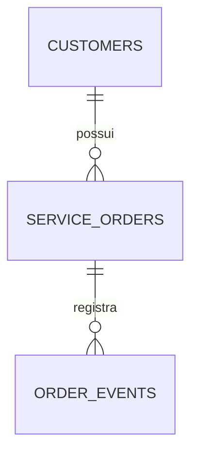

# Banco de dados do Repara

## Modelo implementado



| Tabela | Conteúdo e integridade |
| --- | --- |
| `customers` | Nome, telefone, e-mail opcional e data de cadastro; telefone com 10 ou 11 dígitos |
| `service_orders` | Cliente obrigatório, equipamento, defeito, diagnóstico, orçamento, decisão, serviço, cancelamento, status e datas |
| `order_events` | Ação, status anterior/resultante, observação, valor aprovado opcional e data; vinculado à ordem |

Os nomes internos são em inglês; as telas usam os termos em português do
[escopo aprovado](escopo.md). A migration inicial é `0001` e cria somente o
domínio do Repara. Não contém tabelas de tarefas ou itens das práticas.

IDs são `BIGINT` com `IDENTITY`. Valores monetários usam `NUMERIC(8,2)` e
`Decimal`, com limite de zero a 999.999,99. Datas usam fuso horário
(`TIMESTAMP WITH TIME ZONE`) e são geradas pelo banco. A conexão usa o fuso UTC
para leitura e escrita; a interface apresenta as datas no horário local.
`updated_at` é atualizado nas alterações feitas pelo ORM; não há trigger para
alterações manuais de SQL.

Status, tipos de equipamento, decisões e ações do histórico têm valores
enumerados e restrições `CHECK`. Existem índices nas chaves estrangeiras e
um índice composto de status/data para consultas de acompanhamento.

A chave estrangeira impede deixar ordens sem cliente. O serviço bloqueia a
exclusão de clientes com ordens em andamento. Quando todas estão entregues ou
canceladas, remove essas ordens e o cliente na mesma transação. Excluir uma
ordem remove seus eventos por `ON DELETE CASCADE`, sem excluir o cliente.
A exclusão individual de uma ordem exige status Recebida e apenas o evento
inicial de abertura; essa regra é validada pelo serviço.

O histórico possui apenas consulta pela API. As transições do atendimento
e seus eventos são persistidos na mesma transação, com rollback em falhas.

## Configuração e execução local

Requisitos adicionais: Docker com Compose v2 ativo. O `compose.yaml` executa
PostgreSQL, API e frontend no projeto `repara`. Os comandos abaixo iniciam
somente o banco para desenvolvimento com Python local. Para executar os três
serviços, siga o [guia Docker](docker.md).

Na raiz do repositório:

```bash
make install
make env-init
make db-up
make db-upgrade-local
make db-current-local
make db-check
make db-status
```

`env-init` copia `.env.example` para `.env` somente se o arquivo ainda não
existir. Revise os valores antes de iniciar o banco. O Alembic e a configuração
Python leem o `.env` da raiz sem substituir variáveis já definidas no ambiente.
`db-current-local` deve indicar `0001 (head)`; `db-check` confirma ausência de
diferenças entre models e migrations.

| Variável | Uso |
| --- | --- |
| `POSTGRES_DB` | Nome do banco criado pelo contêiner |
| `POSTGRES_USER` | Usuário local do PostgreSQL |
| `POSTGRES_PASSWORD` | Senha do banco; o Compose exige que esteja preenchida |
| `DB_PORT` | Porta publicada no host; padrão 5432, vinculada a 127.0.0.1 |
| `DATABASE_URL` | URL `postgresql+psycopg://...` usada por Python e Alembic |

Os valores de `.env.example` são exemplos locais. Senhas reais não devem ser
versionadas. A configuração não oferece uma URL com senha embutida como
fallback: operações de banco exigem `DATABASE_URL` válida.

Se a porta 5432 estiver ocupada, altere **DB_PORT e a porta de DATABASE_URL**
no `.env` para o mesmo valor livre, por exemplo 5434. Alterar somente DB_PORT
não modifica automaticamente a URL do Python. Na API em contêiner,
o Compose usa o host `db` e a porta interna 5432. Para a stack completa,
veja [Docker](docker.md).

`make db-down` encerra o projeto `repara` e preserva seu volume `repara-data`.
Credenciais POSTGRES_* inicializam um volume novo: mudar essas variáveis não
altera automaticamente usuários/senhas de um banco já existente.

## Novas migrations

Depois de alterar os models e com o banco no head atual:

```bash
make db-migration msg="descricao_da_alteracao"
make db-upgrade-local
make db-check
```

Revise sempre a migration gerada antes de aplicá-la. Migrations são snapshots
versionados do schema; não importam os models atuais para criar tabelas.

## Testes reais com isolamento

```bash
make check-backend
make test-postgres
```

`check-backend` executa Ruff, formatação e testes locais. Sem
`TEST_DATABASE_URL`, os testes de banco são pulados com indicação para usar
`make test-postgres`; os testes de saúde e configuração continuam sem Docker.

`test-postgres` executa toda a suíte do backend e cria um projeto Compose
exclusivo com sufixo aleatório, senha
temporária, porta livre e dados em `tmpfs`, usando `compose.test.yaml`. Cada
teste também cria seu próprio schema, sem migrar o schema `public`. A suíte
verifica upgrade, revisão head, compatibilidade com os models, downgrade e
reupgrade, persistência entre conexões, valores inválidos e chaves estrangeiras.

Os testes HTTP de clientes compartilham a fixture de schema isolado, com uma
sessão por requisição. O runner remove seu contêiner e sua rede ao terminar, inclusive em falha dos
testes; os dados temporários deixam de existir. Não usa volumes persistentes,
não executa `down -v` e não acessa o banco de desenvolvimento. Não é necessário
configurar `.env` para esse comando.
