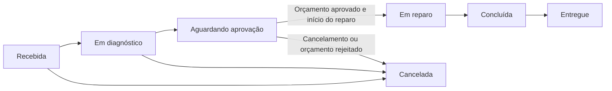

# Escopo e regras de negócio do Repara

Estado: escopo da primeira versão aprovado pelo aluno em 15/11/2026.
Este documento registra o escopo aprovado e as regras atuais da primeira versão.
As instruções de execução e validação estão no README e nos guias técnicos.

## Problema e público

Uma pequena assistência técnica precisa saber quais equipamentos recebeu,
qual defeito foi informado, o que foi diagnosticado, se o cliente aprovou o
orçamento e quais serviços estão prontos para entrega. Anotações dispersas
dificultam acompanhar o atendimento e recuperar decisões anteriores.

O Repara será usado pelo atendente ou técnico da assistência, em uma operação
local. O cliente não acessará o sistema nesta versão. O atendimento será voltado
a computadores e notebooks. O nome Repara é provisório e pode ser alterado sem
mudar as regras do domínio.

## Objetivo da primeira versão

Permitir cadastrar clientes e gerenciar ordens de serviço com CRUD pela
interface, diagnóstico, orçamento, registro da decisão do cliente, reparo,
entrega e histórico persistido. O operador registra no sistema uma aprovação
recebida presencialmente ou por outro meio; o sistema não envia mensagens nem
oferece aprovação on-line ao cliente.

## Funcionalidades e telas

| Tela | Comportamento planejado |
| --- | --- |
| Clientes | Listar, pesquisar por nome, cadastrar, consultar, editar e excluir quando permitido |
| Ordens | Listar e pesquisar por número, nome do cliente e status; abrir uma ordem |
| Detalhe da ordem | Consultar equipamento, cliente, diagnóstico, orçamento, decisão e histórico; editar ou excluir quando permitido |
| Atendimento | Iniciar diagnóstico, solicitar aprovação, registrar decisão, iniciar reparo, concluir, entregar ou cancelar conforme as regras |
| Painel | Contar ordens abertas, aguardando decisão e prontas para entrega usando dados reais |

Formulários terão validação e estados de envio, sucesso e erro. Listagens terão
carregamento, estado vazio e erro. Exclusão, cancelamento, rejeição de orçamento
e entrega exigirão confirmação. Falhas de envio preservarão os campos digitados.

## Dados do domínio

### Cliente

| Campo | Regra |
| --- | --- |
| ID | Gerado pelo banco, imutável |
| Nome | Obrigatório, de 1 a 100 caracteres após remover espaços das extremidades |
| Telefone | Obrigatório; armazenar 10 ou 11 dígitos, aceitando máscara na interface |
| E-mail | Opcional, até 254 caracteres; validar formato quando informado |
| Data de cadastro | Gerada pelo sistema |

Não será exigido CPF, endereço ou unicidade de telefone/e-mail: pessoas podem
compartilhar um contato. Um cliente terá zero ou várias ordens. Alterar o contato
atualizará os dados exibidos em suas ordens; não haverá histórico cadastral.

### Ordem de serviço

| Campo | Regra |
| --- | --- |
| ID / número da ordem | Identificador numérico gerado pelo banco, imutável; usado na pesquisa |
| Cliente | Referência obrigatória a um cliente existente |
| Tipo do equipamento | Computador ou notebook |
| Marca e modelo | Obrigatórios, de 1 a 100 caracteres cada |
| Número de série | Opcional, até 100 caracteres; sem unicidade obrigatória |
| Defeito relatado | Obrigatório, de 1 a 2.000 caracteres |
| Diagnóstico | Até 2.000 caracteres; obrigatório para solicitar aprovação |
| Valor do orçamento | Em reais, decimal com até duas casas; de R$ 0,00 a R$ 999.999,99; obrigatório para solicitar aprovação |
| Decisão do orçamento | Sem solicitação, pendente, aprovado ou rejeitado; controlada pelas operações do atendimento |
| Serviço realizado | Até 2.000 caracteres; obrigatório para concluir o reparo |
| Motivo de cancelamento | De 1 a 500 caracteres; obrigatório ao cancelar ou rejeitar orçamento |
| Status | Controlado pelo fluxo abaixo; nunca alterado livremente no formulário |
| Datas de criação e atualização | Geradas pelo sistema |

O equipamento fará parte da ordem; não terá cadastro separado. Um mesmo
equipamento poderá voltar em uma nova ordem. Campos textuais obrigatórios não
aceitarão apenas espaços. Valores monetários não serão armazenados em ponto
flutuante. Datas serão registradas em UTC e exibidas no horário local.

### Histórico de atendimento

Cada ordem terá eventos com ID, ordem, tipo da ação, status anterior (vazio na
abertura), status resultante, data e observação quando aplicável. Abertura,
transições de status e decisão do orçamento gerarão eventos. Rejeição e
cancelamento registrarão o motivo; aprovação registrará o valor aprovado.

Eventos serão somente de leitura pela interface e API: não haverá edição ou
exclusão individual. A alteração da ordem e seu evento serão salvos na mesma
transação. Esta versão não registrará cada edição textual nem identificação
de operador, pois não haverá contas de usuário.

## Fluxo e transições permitidas

| Ação | Origem → destino | Condições |
| --- | --- | --- |
| Abrir ordem | Nova → Recebida | Cliente existente e dados obrigatórios válidos; decisão sem solicitação |
| Iniciar diagnóstico | Recebida → Em diagnóstico | Ordem existente |
| Solicitar aprovação | Em diagnóstico → Aguardando aprovação | Diagnóstico preenchido e orçamento válido; decisão passa a pendente |
| Aprovar orçamento | Aguardando aprovação → mesmo status | Decisão pendente; registrar aprovação no histórico |
| Rejeitar orçamento | Aguardando aprovação → Cancelada | Decisão pendente e motivo obrigatório; decisão passa a rejeitado |
| Iniciar reparo | Aguardando aprovação → Em reparo | Decisão aprovada |
| Concluir reparo | Em reparo → Concluída | Serviço realizado preenchido |
| Entregar equipamento | Concluída → Entregue | Confirmação do operador |
| Cancelar ordem | Recebida, Em diagnóstico ou Aguardando aprovação → Cancelada | Motivo obrigatório; aprovação prévia não impede cancelar antes do reparo |

Status não retrocedem. Entregue e Cancelada são finais. Não haverá reabertura,
revisão de orçamento já solicitado, aprovação repetida nem cancelamento após
início do reparo nesta versão. Uma correção de atendimento encerrado será tratada
como nova ordem. Repetir uma ação já concluída retorna conflito, sem novo evento.

Aprovar não inicia o reparo automaticamente. Enquanto aprovado e ainda sem
iniciar reparo, o status continuará Aguardando aprovação, com a decisão Aprovado
visível. O painel de aguardando decisão contará somente decisões pendentes.

## Regras de edição e exclusão

- Cliente: pode editar nome e contato a qualquer momento. Pode excluir se não
  houver ordens ou se todas estiverem entregues ou canceladas. A confirmação
  informa que essas ordens e seus históricos também serão removidos na mesma
  transação. Qualquer ordem em andamento bloqueia a exclusão e preserva tudo.
- Ordem Recebida: pode corrigir cliente, equipamento e defeito relatado. Pode
  excluir com confirmação se ainda houver apenas o evento inicial de abertura;
  nesse caso, a exclusão remove também esse evento na mesma transação.
- Ordem Em diagnóstico: cliente, equipamento e defeito ficam bloqueados; pode
  editar diagnóstico e orçamento antes de solicitar aprovação.
- Ordem Aguardando aprovação: diagnóstico e orçamento ficam bloqueados; apenas
  ações de decisão, início do reparo ou cancelamento conforme a tabela.
- Ordem Em reparo: pode editar a descrição do serviço realizado até concluir.
- Ordem Concluída: pode apenas registrar a entrega.
- Ordens Entregue ou Cancelada: ficam disponíveis somente para consulta;
  podem ser removidas junto com a exclusão confirmada do cliente.
- Uma ordem com andamento não pode ser excluída. Cancelamento preserva os dados
  e o histórico; não equivale a exclusão.

Regras serão validadas no backend mesmo quando a interface bloquear uma ação.
Dados inválidos retornarão 422, recurso inexistente 404 e conflito com regras
de negócio 409, com mensagem compreensível. Criação retornará 201; exclusão
bem-sucedida, 204. A interface não exibirá detalhes internos de banco ou exceções.

## Indicadores e filtros

- Abertas: Recebida, Em diagnóstico, Aguardando aprovação e Em reparo.
- Aguardando decisão: Aguardando aprovação com decisão pendente.
- Prontas para entrega: Concluída.
- Pesquisa de ordens: número exato, parte do nome do cliente e status;
  filtros podem ser combinados. Ordenação padrão: mais recentes primeiro.

Os indicadores podem se sobrepor: aguardando decisão é um subconjunto de abertas.
Não haverá gráficos financeiros, faturamento, cobrança ou gestão de pagamentos.

## Stack e arquitetura

| Área | Tecnologia e responsabilidade |
| --- | --- |
| Backend | Python, FastAPI e Poetry; Ruff para lint e formatação |
| Organização | Rotas HTTP → serviços de negócio → repositórios; schemas de entrada/saída e models de persistência |
| Banco | PostgreSQL, SQLAlchemy e migrations versionadas com Alembic |
| Frontend | React em JavaScript, Vite, Tailwind, fetch e Biome |
| Integração | CORS com origens explícitas e métodos usados pelo CRUD e atendimento |
| Testes | Pytest; Vitest e Testing Library; Playwright com API e banco reais |
| Infraestrutura | Dockerfiles, Docker Compose, variáveis de ambiente e .env.example |
| Comandos e CI | Makefile e GitHub Actions |

O projeto será construído na branch projeto-final, consultando as práticas como
referência de aprendizado, sem trazer o laboratório pronto por merge. Segredos,
dependências instaladas e arquivos gerados não serão versionados.

## Fora desta versão

Login e permissões, portal do cliente, WhatsApp/e-mail automático, pagamentos,
nota fiscal, estoque de peças, anexos/fotos, múltiplas filiais, garantia,
assinatura digital, deploy em nuvem e microsserviços adicionais.

## Roteiro de aceitação planejado

1. Cadastrar, consultar e editar um cliente; excluir outro cliente sem ordens.
2. Abrir uma ordem; consultar e editar enquanto Recebida; excluir uma ordem
   de teste que ainda não teve andamento.
3. Iniciar diagnóstico, preencher diagnóstico e orçamento e solicitar aprovação.
4. Confirmar que não se pode iniciar reparo sem aprovação.
5. Aprovar, iniciar reparo, registrar serviço realizado e concluir.
6. Recarregar a página e confirmar dados, status, valor e histórico persistidos.
7. Entregar e confirmar o estado final; verificar filtros e painel.
8. Em outra ordem, rejeitar orçamento e confirmar cancelamento com motivo.
9. Confirmar bloqueio de exclusão de cliente com ordem em andamento e de ordem
   com andamento. Confirmar exclusão de cliente com apenas ordens encerradas.

Cada funcionalidade terá testes durante sua implementação. A validação final
reunirá testes, lint, formatação, build e E2E em um comando make. O README será
atualizado progressivamente com instruções que tenham sido executadas.

## Revisão da tarefa 01

- [x] Problema, público, entidades e campos propostos.
- [x] Fluxo, transições, edição e exclusão explícitos.
- [x] Stack das aulas e limites da versão registrados.
- [x] Escopo revisado e aprovado pelo aluno em 15/11/2026.

Registrar o commit de documentação no cartão e concluir a tarefa 01.
A tarefa 02 inicia a implementação; nenhum recurso deste escopo
deve ser apresentado como pronto antes de sua validação.
